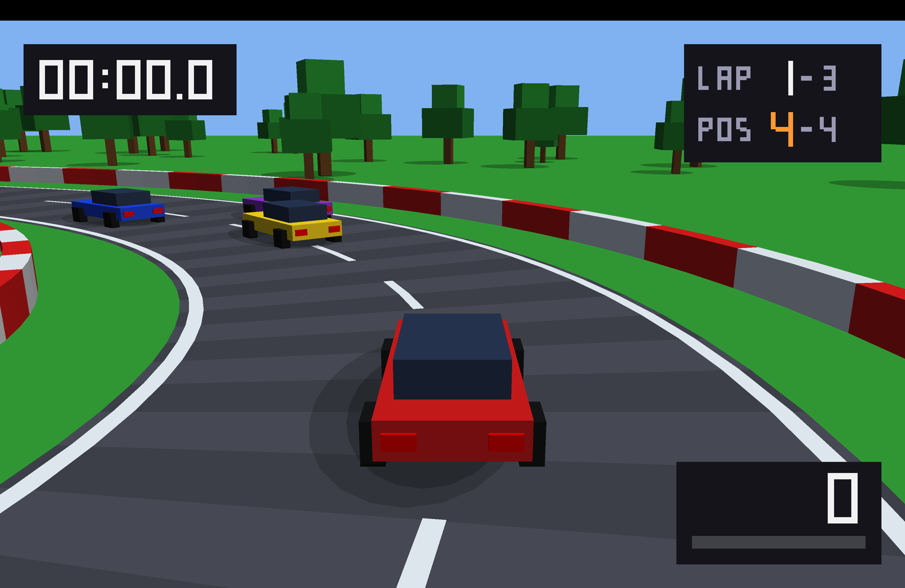

# 🏎️ OpenGL Racing Game

A 3D racing game developed in **C++ using OpenGL**. This project explores real-time graphics, rendering, and interactive gameplay.

## 📌 About the Project

OpenGL Racing Game is a graphics programming project focused on building a racing experience using C++. The repository contains the source code and CMake configuration needed to build the project.

## ✨ Features

- 3D graphics using OpenGL
- Real-time keyboard interaction
- Racing gameplay
- C++ application structure
- CMake-based build system

## 🛠️ Technologies

- **Language:** C++
- **Graphics API:** OpenGL
- **Window and input library:** GLFW
- **Mathematics library:** GLM
- **Build system:** CMake

## 💻 Requirements

Before building, make sure you have:

- A C++ compiler
- CMake 3.20 or later
- OpenGL support
- GLFW
- GLM

The required libraries must be installed and discoverable by CMake.

## 🚀 Getting Started

### 1. Clone the repository

    git clone https://github.com/fahmid-ahmed/OpenGL-Racing-Game.git
    cd OpenGL-Racing-Game

### 2. Configure the project

    cmake -S . -B build

### 3. Build the project

    cmake --build build

### 4. Run the game

On macOS, if the executable is named RacingGame and is generated at the expected path:

    ./build/RacingGame

If the executable is elsewhere, check the build output and use its actual path.

## 🎮 Controls

Check the current game implementation for the supported controls and document them here.

## 📸 Screenshots

### Gameplay

## 🗺️ Future Improvements

- Improve the 3D racing environment
- Add more vehicles and track details
- Enhance lighting and visual effects
- Expand gameplay features

## 👨‍💻 Author

**fahmid-ahmed**

## 📄 License

This project is licensed under the [MIT License](LICENSE).
